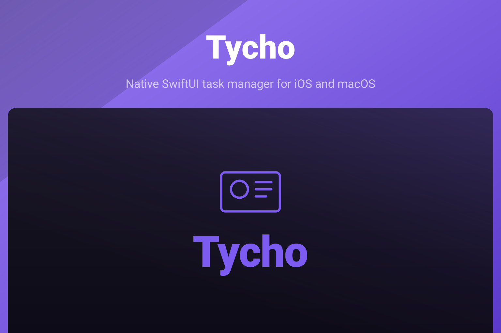

<p align="center">
  
</p>

<p align="center">
  
  
  
</p>

Tycho is a native SwiftUI task manager for iOS 27 and macOS 27, named after Tycho Brahe. It is a native port of
[Gr8r Studio](https://github.com/gr8rstudio/gr8r-studio), keeping the original's interface and principles: projects
with board, list, table, calendar, timeline and files views, task dependencies and attachments, a task
inspector and a focused home screen. Everything runs on-device with SwiftData, and the
schema is ready for CloudKit.

## Install

Tycho is not published to a package registry. Build it from source with Xcode 27. The repository is private, so cloning requires access to the `akira-foundation` organisation:

```sh
git clone https://github.com/akira-foundation/tycho.git
cd tycho
make build
open Tycho.xcodeproj
```

`make build` compiles the app for macOS and the iOS simulator without code signing. Run the `Tycho` scheme from Xcode
to launch it.

## Documentation

- [Index](docs/00-index.md)
- [Architecture](docs/01-architecture.md)
- [Development](docs/02-development.md)

## Testing

```sh
make test      # TychoKit package suite
make build     # macOS and iOS simulator builds
make lint      # SwiftLint and swift-format, strict
make test-ui   # macOS UI tests
```

## Changelog

The changelog is generated from conventional commits via [git-cliff](https://git-cliff.org) and
will be published as `CHANGELOG.md` with the first tagged release.

## Contributing

Please see [CONTRIBUTING.md](CONTRIBUTING.md) for details.

## Security Vulnerabilities

Please review [our security policy](SECURITY.md) on how to report security vulnerabilities.

## Credits

- [Akira Foundation](https://github.com/akira-foundation)
- [Gr8r Studio](https://github.com/gr8rstudio/gr8r-studio), the original this app ports
- [All Contributors](https://github.com/akira-foundation/tycho/graphs/contributors)

## License

Dual-licensed under either of the following, at your option:

- MIT License ([LICENSE-MIT](LICENSE-MIT) or https://opensource.org/licenses/MIT)
- Apache License 2.0 ([LICENSE-APACHE](LICENSE-APACHE) or https://www.apache.org/licenses/LICENSE-2.0)

Unless you explicitly state otherwise, any contribution intentionally submitted for inclusion in
this project by you, as defined in the Apache-2.0 license, shall be dual-licensed as above, without
any additional terms or conditions.
